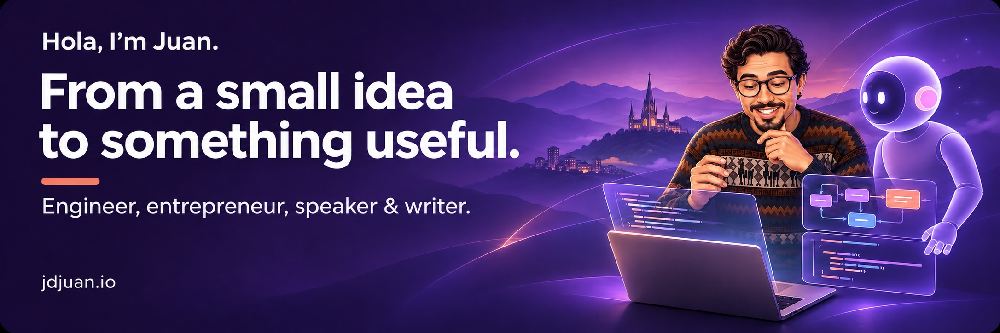

  <a href="https://jdjuan.io"><b>My website</b></a> &nbsp; / &nbsp;
  <a href="#things-you-can-use"><b>Products</b></a> &nbsp; / &nbsp;
  <a href="#notes-from-the-workshop"><b>Articles</b></a> &nbsp; / &nbsp;
  <a href="mailto:david.juanherrera@gmail.com"><b>Say hello</b></a>

### Hey, I'm Juan 👋

I'm a software engineer and entrepreneur. I turn everyday frustrations into tools, experiment with AI, and write about what I learn along the way.

I like simple products, clear explanations, and taking an idea all the way to something people can actually use.

## Open source, made practical

<table>
<tr>
<td width="50%" valign="top">

### 🧩 [MySkills](https://github.com/jdjuan/myskills)

A local home for your installed Codex skills. Browse instructions, organize your collection, and back it up with GitHub.

**Python · Local-first · Developer tools**

[Explore the code](https://github.com/jdjuan/myskills)

</td>
<td width="50%" valign="top">

### 🪄 [SuperChrome](https://github.com/jdjuan/SuperChrome)

Make the browser feel more like yours. Hide distracting feeds, save media, and match Gmail and LinkedIn to your system theme.

**JavaScript · Chrome extension · Everyday tools**

[Explore the code](https://github.com/jdjuan/SuperChrome)

</td>
</tr>
</table>

## Things you can use

Some problems I've turned into products:

| Product | The idea |
| :--- | :--- |
| 💬 **[Parlai](https://www.parlai.app)** | Learn languages through conversations on WhatsApp. |
| 🗣️ **[TandemGPT](https://www.tandem-gpt.com)** | Practice a language with an AI partner. |
| 🔎 **[Full Picture](https://getfullpicture.com)** | Explore information about public figures. |
| 🎯 **[Nine Questions](https://nine.jdjuan.io)** | Challenge your gut feeling. |

[More of my projects](https://jdjuan.io)

## Notes from the workshop

I write about building with AI, thinking clearly, and figuring things out.

- **[How to code with AI](https://jdjuan.io/coding)**: a living record of how my workflow changes.
- **[AI will be the UI](https://jdjuan.io/ui)**: what happens when we talk to products instead of navigating them?
- **[How to review code](https://jdjuan.io/code-review)**: thoughts on automation, human judgment, and understanding what changes.

---

Away from the keyboard: **chess, improv, running**, and the occasional Wikipedia rabbit hole.

Have an idea, a question, or something you're building? **[I'd love to hear about it.](mailto:david.juanherrera@gmail.com)**
